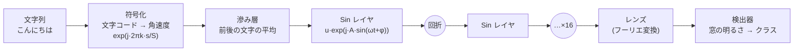

# SinWave — 正弦の干渉と回折で作る学習器

重み行列（ニューロンのマップ）を一切持たず、**正弦波の干渉と回折だけ**で文字列を分類する学習器の実験です。
各レイヤが持つのは **振幅 A・角速度 ω・初期位相 φ** の 3 つの値だけ。光（波）がレイヤを通るたびに回折して広がり、出力面で集まった場所の明るさを特徴にします。

いちばんの特徴は、**別々に学習した「技能」を、強度を足すだけで融合でき、外せば完全に元に戻る**ことです。

> 物理実装は考えていません（計算機上の数値実験です）。光学の言葉を使っていますが、すべて PyTorch で計算しています。

## しくみ



| 部品 | 中身 | 学習するか |
|---|---|---|
| 符号化 | 1 文字 = S 標本の搬送波。文字コード mod S を角速度にする（文字ごとに「光の向き」が変わる） | しない |
| 滲み層 | 各位置で前後の文字との平均をとる（周波数領域では櫛形フィルタ） | しない |
| Sin レイヤ | 位相変調 `u ← u · exp(j · A sin(ωt + φ))`。レイヤを P 区画に分け、区画ごとに (A, ω, φ) を持つ | **する** |
| 回折 | 角スペクトル法による自由空間伝搬（距離 z） | しない |
| 増幅 | レイヤごとに平均強度を 1 に戻す | しない |
| レンズ | 出力の前でフーリエ変換し、遠方場で検出する | しない |
| 照明（任意） | 入射角を変えた平面波 8 通り（tilt）で照らして強度を平均する。異なる位置の文字どうしの干渉を打ち消す | しない |
| 検出器 | 出力面の窓の明るさ → logit（温度 1 個、背景光をクラス数だけ） | 温度・背景光のみ |

1 技能（16 層 × 64 区画）で学習するパラメータは **3072 個**（A, ω, φ）です。ω を固定して A と φ だけ学習すると 2048 個になり、性能は同等かわずかに良くなります（`freeze_w=True`）。

### 融合と取消

技能ごとに 1 本の光路を持たせます。光路どうしは互いに干渉しない（色や偏光の違いを想定）ので、検出器では**強度を足すだけ**で融合できます。

- **並列学習**: 技能 A と B は、互いのデータを一切見ずに別々に学習できる
- **融合**: 光路を並べて強度を足すだけ（追加の学習なし）
- **取消**: 光路を外せば、残りの技能は融合前と完全に同じ出力に戻る

## 結果

合成課題: 各クラスが好む文字（4 字）を持つ文字列の分類。数字はテスト正解率 (%)、3 seed の平均±標準誤差。

| | 2 技能 × 4 クラス | 4 技能 × 4 クラス |
|---|---|---|
| 技能単独（自分の 4 クラス内） | 96.7 ± 0.8 | 96.7 ± 0.3 |
| **別々に学習 → 足すだけで融合**（全クラスから当てる） | **93.5 ± 1.1** | **89.6 ± 0.7** |
| 融合から 1 技能を外した残り | 97.1 ± 0.4 | 91.7 ± 1.0 |
| 参考: 全技能を 1 本の光路で同時に学習（同じ総パラメータ） | 94.7 ± 1.0 | 93.9 ± 0.7 |
| 参考: 文字頻度のロジスティック回帰（全クラス同時） | 97.1 ± 1.0 | 96.3 ± 0.6 |

設定は平均の滲み層 + tilt 照明 8 通り（`preset="best"`）。

そのほか（seed 1 本）:

| 課題 | SinWave | 比較 |
|---|---|---|
| 32 単語の暗記 | 100% | – |
| 順序の判定（「あい」が隣り合うか） | 99%+ | 巡回バイグラムの回帰 100% |
| 16 クラスを 1 光路で（平均の滲み + tilt） | 91.5% | 文字頻度の回帰 95% |
| 実テキスト（CC-100 日本語）で次の 1 文字、64 クラス（直前 2 文字から） | 正解率 43.0%（ω 固定、2048 params）〜 44.1%（12288 params） | 2-gram 42.5% / 3-gram 53.6% |

### 分かったこと

- **強度は振幅の 2 乗なので、異なる位置にある文字どうしの干渉が「位置の雑音」になり、汎化を妨げる。** 大きく効いた工夫は、どれもこれを減らすものだった（非コヒーレント照明 → 乱数を使わない tilt / アダマール照明 → 平均の滲み層）。
- 周期境界の下では、回折だけでは光は一点に集まらない。最後にレンズを置いて遠方場で検出する必要がある。
- 文字を「角速度」で表すと、遠方場では文字が「方向」になり、正弦の格子はそれを ±ω だけ曲げる。構造がよく噛み合う。
- レイヤ全体で (A, ω, φ) を 1 組だけにすると表現力が足りない。区画化が必要。
- 実テキストでは、文字コード mod S による周波数の重なりが天井を決めていた。S を 128 → 1024 にすると 2-gram と並んだ。
- 効かなかった工夫の一覧は [NOTES.md](NOTES.md) にある（層間距離の変更、出力の帰還、広い出力面、対数・差動検出、層ごとのレンズ、前処理光、ばらつきの滲み、入力のフーリエ変換、素数・ゼータのゼロ点による ω の配置など）。

### 限界

- 実テキストの次文字予測では、正解率は 2-gram と同等だが、**確信度（クロスエントロピー）で大きく負ける**（2.53 対 2.10）。温度を合わせ直しても改善しないので、尺度のずれではなく、予測分布の形を表しきれていない。
- 融合する技能が増えると、「どの技能の入力か」の判別が落ちる（4 技能で同時学習より 4 ポイント低い）。
- 計算は軽くない。1 回の推論で長さ 2048 の FFT を層の数だけ行い、照明を使うとさらに 8 倍になる。
- 多くの比較は seed 1 本。3 seed で確かめたのは主要な結果のみ。

## 使い方

```bash
pip install -e .
python examples/quickstart.py
```

```python
from sinwave import SinWaveClassifier, merge

# 技能 A, B を別々に学習する（互いのデータは見ない）。検出器 8 個のうち A が 0-3、B が 4-7 を担当
a = SinWaveClassifier(classes=["挨拶", "天気", "食事", "移動"], slots=[0, 1, 2, 3], n_slots=8, name="A")
a.fit(texts_a, labels_a)
b = SinWaveClassifier(classes=["音楽", "料理", "仕事", "趣味"], slots=[4, 5, 6, 7], n_slots=8, name="B")
b.fit(texts_b, labels_b)

m = merge([a, b])        # 融合（追加の学習なし）
m.predict(["こんにちは"])
m.remove("B")            # 取消: A 単独と完全に同じに戻る

a.save("skill_A.pt")
a = SinWaveClassifier.load("skill_A.pt")
```

- `preset="fast"`（既定、平均の滲み層、計算 1 倍）/ `"best"`（+ tilt 照明、計算 8 倍）/ `"text"`（漢字を含む文向け、S=1024）
- 融合する技能どうしは `n_slots` と preset（`L`, `S`）を揃え、`slots` が重ならないようにする
- `merge(..., mode="gate")` は各光路の「担当検出器に入った光の割合」で技能を選ぶ方式

## ファイル

| パス | 内容 |
|---|---|
| `sinwave/model.py` | モデル本体（符号化、Sin レイヤ、伝搬、照明、滲み層、検出器、並列光路） |
| `sinwave/api.py` | 高水準 API（`SinWaveClassifier`, `merge`） |
| `sinwave/tasks.py` | 合成課題 |
| `exp01`〜`exp06_*.py`, `sweep*.sh` | 実験スクリプト（実験 01〜22） |
| `baseline.py` | 比較用のロジスティック回帰 |
| `results/` | 実験の生の出力 |
| `NOTES.md` | すべての実験の記録（効かなかったものも含む） |
| `tools/fetch_cc100_sample.py`, `tools/prepare_corpus.py` | 実テキスト用のコーパス取得・整形 |
| `tools/zeta_zeros.py` | リーマンゼータのゼロ点の計算（ω の初期配置の実験用、mpmath） |

## 実テキストの実験について

実テキストの実験には CC-100 日本語の先頭部分（約 60 万字）を使いました。**データはこのリポジトリに含めていません**（CC-100 は Common Crawl 由来で、利用条件に従う必要があるため）。再現するには、次で取得してください（圧縮データ約 1MB の通信）。

```bash
python tools/fetch_cc100_sample.py data/cc100_ja.txt --chars 600000
python exp06_nextchar.py --bias --n 2 --M 1 --S 1024 --L 2048
```

## 動作環境

Python 3.10 以上、PyTorch 2.0 以上。実験は RTX 3060 (12GB) で行いました。テスト: `python -m pytest tests -q`（CPU で数十秒）。
