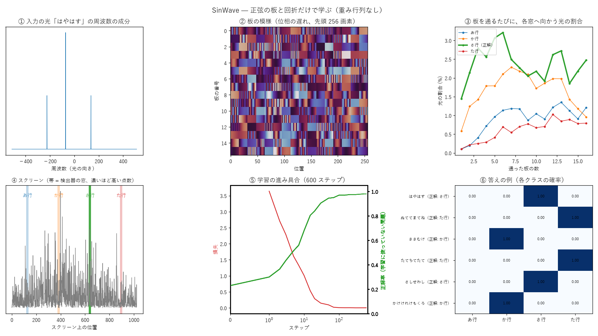
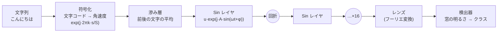

# SinWave — 正弦の干渉と回折で作る学習器

重み行列（ニューロンのマップ）を一切持たず、**正弦波の干渉と回折だけ**で文字列を分類する学習器の実験です。
各レイヤが持つのは **振幅 A・角速度 ω・初期位相 φ** の 3 つの値だけ。光（波）がレイヤを通るたびに回折して広がり、出力面で集まった場所の明るさを特徴にします。

いちばんの特徴は、**別々に学習した「技能」を、強度を足すだけで融合でき、外せば完全に元に戻る**ことです。

> 物理実装は考えていません（計算機上の数値実験です）。光学の言葉を使っていますが、すべて PyTorch で計算しています。
>
> 波や機械学習になじみがない方は、先に [docs/introduction.md](docs/introduction.md)（前提知識なしの解説）をどうぞ。

## 最小版: `sinwave_minimal.py`（まずはこれ）

これまでの実験で分かっている**最も効率の良い構成だけ**を、PyTorch だけで動く **1 ファイル**にまとめたものです。実験用のオプションは入っていません。コメントを多めにしてあるので、ほかのプロジェクトにコピーして改造しやすい形です。成果が出たら、このファイルをバージョンアップしていきます（ファイル先頭に変更履歴）。

```python
import sinwave_minimal as sw

# 一番かんたんな使い方（v1.2）: データから設定を自動で選び、作って学習する。ラベルは名前のままでよい
net = sw.fit(texts, labels)                 # 例: labels = ["挨拶", "天気", ...]
sw.predict_labels(net, ["こんにちは"])       # → ["挨拶"]
print(sw.summary(net))                      # 選んだ設定と大きさ
print(net.auto_reasons)                     # なぜその設定にしたか（文字数・V・L・文字の合わせ方・大きさ）
sw.evaluate(net, test_texts, test_labels)   # 正解率

# 自分で決めるとき: 大きさは size="small" / "medium" / "large"、文字の合わせ方は mix="rainbow" / "color" / "coh"
net = sw.SinWaveNet(n_slots=4, size="medium", mix="color")

# 検出器 8 個のうち、技能 A は 0〜3 番、技能 B は 4〜7 番を担当する。ラベルは検出器の番号
a = sw.train(sw.SinWaveNet(n_slots=8, own=[0, 1, 2, 3]), texts_a, labels_a)
b = sw.train(sw.SinWaveNet(n_slots=8, own=[4, 5, 6, 7]), texts_b, labels_b)

sw.predict(a, ["こんにちは"])     # → [検出器の番号]
m = sw.merge([a, b])              # 融合: 別々に学習した技能を足すだけ
m = sw.merge([a])                 # 取消: 外せば A 単独と完全に同じ
sw.save(a, "a.pt"); a = sw.load("a.pt")   # 1 技能 約 10KB

# 光路の足し算・引き算（共通の出発点 base から derive した技能どうし）
apple = sw.train(sw.derive(base, own=[0, 2, 3]), texts_apple, labels_apple)
both = sw.combine(base, [(1, apple), (1, tomato)])              # 1 本の光路で融合
careful = sw.combine(base, [(1, apple), (-1.5, tomato)], own=[0, 2, 3])   # トマトへの誤反応を減らす

# 語根（部品）の検出器: 例を 1 つも見せない新しい物を、部品の組み合わせとして認識する（v1.1）
roots = sw.train_roots(sw.SinWaveNet(n_slots=8), texts, [[0, 3, 5], [1, 3, 6], ...])  # 各文字列に含まれる部品
sw.compose(roots, ["..."], {"リンゴ": [0, 3, 5], "トマト": [1, 3, 6], "ザクロ": [0, 6, 7]}, seen=["リンゴ", "トマト"])
```

| バージョン | 構成 | 技能単独 | 2 技能の融合 |
|---|---|---|---|
| 1.2.0 | 1.1.0 と同じ学習器に、自動調整（auto_config・fit）、大きさの選択（size）、名前のラベル、evaluate・summary を追加 | （1.1.0 と同じ） | （1.1.0 と同じ） |
| **1.1.0** | **各文字の光がレイヤ全体を照らす入力（`input="wave"`）、虹（位置ごとに周波数を少しずつずらす、`mix="rainbow"`）、周波数を L と互いに素な歩幅で並べ直して L=1024**。語根の検出器 | **97.7 ± 0.5** | **94.6 ± 0.8** |
| 1.1.0 | 同、文字ごとに別の色（`mix="color"`。順序は表せない） | 98.3 ± 0.4 | 95.3 ± 1.0 |
| 1.0.0 | 文字=角速度の区画方式（`input="slot"`）、平均の滲み層、tilt 照明 8 通り (`patterns=8`)、L=2048 | 97.0 ± 0.3 | 93.1 ± 0.2 |
| 1.0.0 | 同、照明なし (`patterns=0`) | 94.6 ± 1.3 | 86.9 ± 1.1 |

2 技能 × 4 クラスの合成課題、3 seed の平均±標準誤差（`python experiments/bench_minimal.py`）。動作例は `python sinwave_minimal.py`。
実験で使ってきた本体（`sinwave/model.py`）と同じ出力になることを `tests/test_minimal.py` で確認しています（区画方式）。v1.0 で保存したファイルはそのまま読み込めます。

実験の歩み（37 の実験の目的・結果・得られたもの・問題点）は [docs/experiments_guide.md](docs/experiments_guide.md) にまとめています。

`sinwave/` パッケージ（`SinWaveClassifier` など）は、任意のラベル名・設定の切り替え・実験用の全オプションを持つ版です。

### 学習の様子を見る

```bash
python examples/visualize.py
```

学習しながら、①入力の光（文字ごとの光の向き）、②板の模様、③板を通るたびに各窓へ向かう光の割合、④スクリーンと検出器の窓、⑤学習の進み具合、⑥答えの例を描いて更新します（CPU でも数分）。`--gif` で学習の途中をアニメーションとして保存できます。



③を見ると、板を通るたびに、正解のクラス（太線）へ向かう光が増えていきます。窓に届く光は全体の数 % だけで、答えは「わずかな光の差」で決まっています。

## 一目でわかる SinWave

### 長所
- **重み行列（マップ）が不要。** ニューラルネットの「入力 × 出力」の巨大な表を持たない。学習するのは、各レイヤの区画ごとの (振幅, 角速度, 初期位相) だけで、1 技能 2048〜3072 個。保存ファイルは 1 技能 約 23 KB。
- **技能を「足すだけ」で融合できる。** 技能ごとに別の光路を持たせ、出力の明るさを足すだけで 1 つの分類器になる。融合のための追加学習も、相手の学習データも要らない。
- **完全に取り消せる。** 光路を外せば、残りは融合前と 1 桁も違わない出力に戻る。ニューラルネットで問題になる「新しいことを覚えると古いことを忘れる」（破滅的忘却）が、構造上起きない。
- **共通の出発点からなら、光路の足し算・引き算もできる。** 同じ出発点から派生させた技能どうしは、パラメータを足すだけで 1 本の光路に融合できる（計算が増えない）。似た技能を引くと、その技能に似た入力への誤反応が減る（「やってはいけないこと」を引き算で入れる）。
- **並列に学習できる。** 技能ごとに別の場所・別のデータ・別の時間に学習してよい。データを分けて学習し、あとで足しても、全データで 1 本学習したのとほぼ同等（実テキストで確認）。
- **何が起きているか追いやすい。** すべての部品が波の物理（回折・干渉・フィルタ）で説明できる。たとえば「文字は角速度＝光の向き」「正弦レイヤは光を ±ω だけ曲げる」。

### 短所
- **精度はまだ単純な手法並み。** 合成課題の技能単独で、文字頻度のロジスティック回帰と同等（約 97%）。実テキストでは 2-gram と 3-gram の間。
- **実テキストでは 3-gram に届かない。** 次文字予測で、正解率は 2-gram を上回る（51% 対 42.5%）、確信度でも上回る（CE 1.97 対 2.10）が、3-gram（53.6%）には届かない。1 文字ずつ入れて前の出力の光を混ぜる「光の記憶」で、文脈が伸びるほど良くなるようになった（実験41）。
- **技能が増えるほど融合後の判別が落ちる。** 4 技能で、全部を同時に学習した場合より約 4 ポイント低い。
- **計算は軽くない。** パラメータは少ないが、推論のたびに長さ 1024 の FFT をレイヤの数だけ行う。虹や色ごとの入力では、さらに 8〜10 倍。
- **入力の符号化に精度が縛られる。** 文字を角速度で表すので、区別できる文字の種類は周波数の数（S）で決まる。
- **長い文字列は先頭しか使われない。** 使うのは先頭 max_chars 文字（既定 10 文字）。超えた部分は無視される（警告が出る）。今のところ「短い文字列の分類」向け。

### 向いている使い方
- 技能やクラスを**後から足したり外したりする**必要がある場面（利用者ごとの語彙、期間限定の分類、削除要求に正確に応える必要がある場合など）
- 学習データを**一か所に集められない**場面（各所で別々に学習し、結果だけを持ち寄って足す）
- 「何を覚えさせたか」を**部品単位で管理したい**場面（光路 = 技能が 1 対 1 に対応する）
- 将来の話として、**波を直接扱う物理系**（光学素子、電波・レーダーの信号処理）。この方式は、もともと波の位相と周波数だけで計算している。

### 向いていない使い方
- 最高精度が必要な場面（普通のニューラルネットの方が強い）
- 予測の確率そのものが重要な場面（言語モデルの尤度など）
- 計算時間を最小にしたい場面

## しくみ



| 部品 | 中身 | 学習するか |
|---|---|---|
| 符号化 | 1 文字 = S 標本の搬送波。文字コード mod S を角速度にする（文字ごとに「光の向き」が変わる） | しない |
| 滲み層 | 各位置で前後の文字との平均をとる（周波数領域では櫛形フィルタ） | しない |
| Sin レイヤ | 位相変調 `u ← u · exp(j · A sin(ωt + φ))`。レイヤを P 区画に分け、区画ごとに (A, ω, φ) を持つ | **する** |
| 回折 | 角スペクトル法による自由空間伝搬（距離 z） | しない |
| 増幅 | レイヤごとに平均強度を 1 に戻す | しない |
| レンズ | 出力の前でフーリエ変換し、遠方場で検出する | しない |
| 照明（任意） | 入射角を変えた平面波 8 通り（tilt）で照らして強度を平均する。異なる位置の文字どうしの干渉を打ち消す | しない |
| 検出器 | 出力面の窓の明るさ → logit（温度 1 個、背景光をクラス数だけ） | 温度・背景光のみ |

1 技能（16 層 × 64 区画）で学習するパラメータは **3072 個**（A, ω, φ）です。ω を固定して A と φ だけ学習すると 2048 個になり、性能は同等かわずかに良くなります（`freeze_w=True`）。

### 融合と取消

技能ごとに 1 本の光路を持たせます。光路どうしは互いに干渉しない（色や偏光の違いを想定）ので、検出器では**強度を足すだけ**で融合できます。

- **並列学習**: 技能 A と B は、互いのデータを一切見ずに別々に学習できる
- **融合**: 光路を並べて強度を足すだけ（追加の学習なし）
- **取消**: 光路を外せば、残りの技能は融合前と完全に同じ出力に戻る

## 結果

合成課題: 各クラスが好む文字（4 字）を持つ文字列の分類。数字はテスト正解率 (%)、3 seed の平均±標準誤差。

| | 2 技能 × 4 クラス | 4 技能 × 4 クラス |
|---|---|---|
| 技能単独（自分の 4 クラス内） | 96.7 ± 0.8 | 96.7 ± 0.3 |
| **別々に学習 → 足すだけで融合**（全クラスから当てる） | **93.5 ± 1.1** | **89.6 ± 0.7** |
| 融合から 1 技能を外した残り | 97.1 ± 0.4 | 91.7 ± 1.0 |
| 参考: 全技能を 1 本の光路で同時に学習（同じ総パラメータ） | 94.7 ± 1.0 | 93.9 ± 0.7 |
| 参考: 文字頻度のロジスティック回帰（全クラス同時） | 97.1 ± 1.0 | 96.3 ± 0.6 |

設定は平均の滲み層 + tilt 照明 8 通り（`preset="best"`）。

そのほか（seed 1 本）:

| 課題 | SinWave | 比較 |
|---|---|---|
| 32 単語の暗記 | 100% | – |
| 順序の判定（「あい」が隣り合うか） | 99%+ | 巡回バイグラムの回帰 100% |
| 16 クラスを 1 光路で（平均の滲み + tilt） | 91.5% | 文字頻度の回帰 95% |
| 実テキスト（CC-100 日本語）で次の 1 文字、64 クラス（直前 2 文字から） | 正解率 44.0%（2048 params）〜 51.1%（16384 params、光の記憶）〜 **53.5%**（131072 params、光の記憶を大きく、CE 1.81、実験47） | 2-gram 42.5% / CE 2.10、3-gram 53.6% / CE 1.80、GRU（最良の大きさ）53.3% / CE 1.81 |

### 光路の足し算・引き算（タスク算術）

共通の出発点 θ0（バナナ・ブドウだけを学習）から、リンゴ技能 θA（トマトは見ない）とトマト技能 θT（リンゴは見ない）を派生させた。ΔA = θA − θ0、ΔT = θT − θ0。
リンゴとトマトは好む文字を 2 字共有する（似ている）。3 seed の平均 (%)。

| 光路 | トマトを「リンゴ」と誤認 | リンゴの正答 | 4 種の正答 |
|---|---|---|---|
| リンゴ技能そのまま | 74.0 | 97.1 | 73.4 |
| θ0 + ΔA − 1.5·ΔT（トマトを引く） | **45.1** | 91.1 | 70.7 |
| θ0 + ΔA + ΔT（足す、1 本の光路） | – | 95.3 | **90.5** |
| 参考: 並列光路で融合（2 本） | – | 93.7 | 90.3 |
| 対照: ゼロから別々に学んだ光路どうしの引き算 | （壊れる） | | 25〜35 |

### 分かったこと

- **強度は振幅の 2 乗なので、異なる位置にある文字どうしの干渉が「位置の雑音」になり、汎化を妨げる。** 大きく効いた工夫は、どれもこれを減らすものだった（非コヒーレント照明 → 乱数を使わない tilt / アダマール照明 → 平均の滲み層）。
- 周期境界の下では、回折だけでは光は一点に集まらない。最後にレンズを置いて遠方場で検出する必要がある。
- 文字を「角速度」で表すと、遠方場では文字が「方向」になり、正弦の格子はそれを ±ω だけ曲げる。構造がよく噛み合う。
- レイヤ全体で (A, ω, φ) を 1 組だけにすると表現力が足りない。区画化が必要。
- 実テキストでは、文字コード mod S による周波数の重なりが天井を決めていた。S を 128 → 1024 にすると 2-gram と並んだ。
- 照明パターンの平均に重みを付ける（重み付きの逆拡散）と、どの位置どうしの干渉を残すかを選べる。隣どうしだけ残すと、干渉を全部消して崩れていた順序の課題が 62.5% → 100% に戻った。重みは学習させてもよい。
- **部品（語根）で覚えておけば、例を 1 つも見せない新しい物を、部品の組み合わせとして認識できる**（新しい 4 種の中で 89.7%、偏りを補正すると全部の中からでも 77.5%。実験34・36）。
- **必要な L は「区別したい物の数」で決まる。** 周波数を L と互いに素な歩幅で並べ直せば、L=4096 → 1024 でも同等以上（実験35）。オシロスコープの等価時間標本化と同じ考え方。
- **光の記憶**: 出力の光をそのまま次の入力に戻せる（窓を各文字の周波数の位置に置く）。前の出力の光を混ぜれば、同じ文字でも直前の文字で答えを出し分け（100%、実験38）、本物の文章では文脈が伸びるほど良くなる（実験41）。
- **順番つきの出力**: 位相の符号で位置ごとに分けて取り出し、取り出しの符号を学習させると、ずらし・逆順などの並べ替えがほぼ 100%（実験33・37）。
- 効かなかった工夫の一覧は [NOTES.md](NOTES.md) にある（閾値の増幅曲線、マイナスの明るさ（1 本の光路内）、焦点の強さ、虹の分散、出力面全体を周波数として読む、層間距離の変更、出力の帰還、広い出力面、対数・差動検出、層ごとのレンズ、前処理光、ばらつきの滲み、入力のフーリエ変換、素数・ゼータのゼロ点による ω の配置など）。

### 限界

- 実テキストの次文字予測では、正解率は 2-gram を上回るが、**確信度（クロスエントロピー）は 2-gram にわずかに負け**（2.17 対 2.10）、3-gram（53.6% / 1.80）には届かない。小さいモデルでは差が大きく（2.55）、温度の合わせ直しでは改善せず、容量と学習量で縮まった。
- 融合する技能が増えると、「どの技能の入力か」の判別が落ちる（4 技能で同時学習より 4 ポイント低い）。
- 計算は軽くない。1 回の推論で長さ 1024 の FFT を層の数だけ行い、虹や色ごとの入力ではさらに 8〜10 倍になる。
- 多くの比較は seed 1 本。3 seed で確かめたのは主要な結果のみ。

## 使い方

```bash
pip install -e .
python examples/quickstart.py
```

```python
from sinwave import SinWaveClassifier, merge

# 技能 A, B を別々に学習する（互いのデータは見ない）。検出器 8 個のうち A が 0-3、B が 4-7 を担当
a = SinWaveClassifier(classes=["挨拶", "天気", "食事", "移動"], slots=[0, 1, 2, 3], n_slots=8, name="A")
a.fit(texts_a, labels_a)
b = SinWaveClassifier(classes=["音楽", "料理", "仕事", "趣味"], slots=[4, 5, 6, 7], n_slots=8, name="B")
b.fit(texts_b, labels_b)

m = merge([a, b])        # 融合（追加の学習なし）
m.predict(["こんにちは"])
m.remove("B")            # 取消: A 単独と完全に同じに戻る

# 共通の出発点から派生させた技能は、足し算・引き算できる（1 本の光路のまま）
from sinwave import combine
base = SinWaveClassifier(classes=["バナナ", "ブドウ"], slots=[2, 3], n_slots=4).fit(texts_0, labels_0)
apple = base.derive(["リンゴ", "バナナ", "ブドウ"], slots=[0, 2, 3]).fit(texts_a, labels_a)
tomato = base.derive(["トマト", "バナナ", "ブドウ"], slots=[1, 2, 3]).fit(texts_t, labels_t)
both = combine(base, [(1, apple), (1, tomato)])           # 足し算で融合
careful_apple = combine(base, [(1, apple), (-1.5, tomato)],
                        classes=apple.classes, slots=apple.slots)  # トマトへの誤反応を減らしたリンゴ

a.save("skill_A.pt")
a = SinWaveClassifier.load("skill_A.pt")
```

- `preset="fast"`（既定、平均の滲み層、計算 1 倍）/ `"best"`（+ tilt 照明、計算 8 倍）/ `"text"`（漢字を含む文向け、S=1024）
- 融合する技能どうしは `n_slots` と preset（`L`, `S`）を揃え、`slots` が重ならないようにする
- `merge(..., mode="gate")` は各光路の「担当検出器に入った光の割合」で技能を選ぶ方式

## ファイル

```
sinwave_minimal.py  最小版（1 ファイル、PyTorch のみ）← まずはここ
sinwave/            ライブラリ本体（全オプション版）
  api.py              高水準 API（SinWaveClassifier, merge, combine）
  model.py            光学モデル（符号化、Sin レイヤ、回折、照明、滲み層、検出器、並列光路）
  tasks.py            合成課題
  zeta_zeros.txt      リーマンゼータのゼロ点（ω の初期配置の実験用）
examples/quickstart.py  使い方の例
examples/visualize.py   学習の様子を絵で見る（説明用）
tests/                  テスト（test_minimal.py は最小版と本体の出力の一致も確認）
docs/introduction.md    前提知識がない人向けの解説
experiments/          実験スクリプト（実験 01〜27）。リポジトリ直下で実行する
  exp01_learnability.py   1 光路の学習（多くの実験はこれのオプション違い）
  exp02〜05               追加・取消・融合・並列光路
  exp06_nextchar.py       実テキストの次文字予測
  exp23_arith.py          光路の足し算・引き算
  baseline.py             比較用のロジスティック回帰
  bench_minimal.py        最小版の性能確認
  sweeps/                 各実験の条件をまとめたシェルスクリプト（sweepNN.sh = 実験 NN）
results/              実験の生の出力
NOTES.md              すべての実験の記録（効かなかったものも含む）
tools/                コーパス取得・整形（CC-100）、ゼータのゼロ点の計算
```

## 実テキストの実験について

実テキストの実験には CC-100 日本語の先頭部分（約 60 万字）を使いました。**データはこのリポジトリに含めていません**（CC-100 は Common Crawl 由来で、利用条件に従う必要があるため）。再現するには、次で取得してください（圧縮データ約 1MB の通信）。

```bash
python tools/fetch_cc100_sample.py data/cc100_ja.txt --chars 600000
python experiments/exp06_nextchar.py --bias --n 2 --M 1 --S 1024 --L 2048 --freeze_w
```

## 動作環境

Python 3.10 以上、PyTorch 2.0 以上。実験は RTX 3060 (12GB) で行いました。テスト: `python -m pytest tests -q`（CPU で数十秒）。

## データの出典

- **CC-100 日本語**（実テキストの実験、実験06〜）: Common Crawl 由来。リポジトリには含めない（`tools/fetch_cc100_sample.py` で取得）。
- **KRADFILE**（漢字の部品の分解、実験40）: This project uses the KRADFILE file from the [Electronic Dictionary Research and Development Group (EDRDG)](https://www.edrdg.org/), used in conformance with the Group's [licence](https://www.edrdg.org/edrdg/licence.html) (CC BY-SA 4.0)。取得元 `http://ftp.edrdg.org/pub/Nihongo/kradfile.gz`。リポジトリには含めない（`data/krad/` に置く）。

## ライセンス

[MIT License](LICENSE)。ただし `tools/fetch_cc100_sample.py` で取得する CC-100 のテキストはこのライセンスの対象外で、Common Crawl の利用条件に従います。
