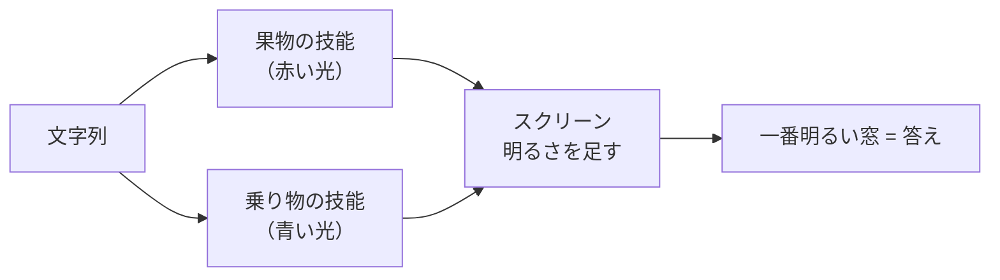

# はじめての SinWave — 前提知識なしの解説

このページは、機械学習や波の物理になじみがない人向けに、SinWave が「何をしていて、何がうれしいのか」を例えを使って説明します。数式はほとんど使いません。
もっと詳しく知りたくなったら [README](../README.md)、すべての実験の記録は [NOTES.md](../NOTES.md) を見てください。

---

## 1. 「学習器」とは

学習器は、たくさんの例を見て「仕分けのルール」を自分で身につける仕組みです。

たとえば、郵便物を「請求書」「広告」「手紙」に仕分ける係を考えます。最初はでたらめに仕分けますが、正解を教えてもらうたびに少しずつコツをつかみ、やがて初めて見る郵便物も正しく仕分けられるようになります。これが「学習」です。

SinWave は、短い文字列（たとえば「こんにちは」）を見て、それがどの種類（クラス）かを当てる学習器です。

### ふつうの学習器（ニューラルネット）のしくみ

いま主流の学習器であるニューラルネットは、内部に**巨大な数の表**（重み行列、このプロジェクトでは「マップ」と呼んでいます）を持っています。
入力の数字に表の数字を掛けて足し合わせる、という計算を何段も重ねて答えを出します。学習とは、この表の数字を少しずつ調整することです。

この方式はとても強力ですが、次のような悩みがあります。

- **後から覚えさせると、前のことを忘れる。** 新しい仕分けを教えると表全体が書き換わり、古い仕分けが下手になります（「破滅的忘却」と呼ばれます）。
- **一部だけを取り消せない。** 「この仕分けだけ忘れさせたい」と思っても、知識が表全体に溶け込んでいるので取り出せません。
- **別々に学んだものを合体できない。** 2 人の係がそれぞれ覚えたコツを、あとから 1 人分にまとめるのは困難です。

SinWave は、この表を持たずに、**波（光）の性質だけで**仕分けをしてみよう、という実験です。

---

## 2. 波の基礎

### 正弦波と 3 つの数

波の基本の形は「正弦波（サイン波）」です。海の波や音の波を、なめらかに整えた形だと思ってください。

```
  山      山      山
 /  \    /  \    /  \
/    \  /    \  /    \
      \/      \/      \/
      谷      谷      谷
```

正弦波は、次の 3 つの数で形が決まります。SinWave のレイヤが持つのは、まさにこの 3 つです。

| 名前 | 意味 | 例え |
|---|---|---|
| **振幅** A | 山の高さ | 波の大きさ |
| **角速度** ω | 山がどれだけ詰まって並ぶか | 縞の細かさ |
| **初期位相** φ | 波が左右にどれだけずれているか | 波のタイミング |

### 干渉: 波は重なると強め合ったり消し合ったりする

2 つの波が同じ場所で重なると、足し算されます。

- 山と山が重なると、もっと高い山になる（**強め合い**）
- 山と谷が重なると、打ち消し合って平らになる（**弱め合い**）

池に石を 2 つ投げると、波紋が重なって、波が大きくなる場所と静かな場所が縞模様のように並びます。これが**干渉**です。

### 回折: 波は広がりながら進む

波はまっすぐ進むだけでなく、少しずつ横に広がります。隙間を通った光や、塀の向こうに回り込む音がその例です。これを**回折**と呼びます。

### 明るさは「振幅の 2 乗」

目やカメラが感じるのは光の**明るさ**だけです。明るさは振幅の 2 乗で、波のタイミング（位相）は直接は見えません。
ただし、位相が違う光どうしが重なると干渉で明るさが変わるので、**位相の違いは干渉を通して明るさに現れます**。SinWave はこれを利用します。

---

## 3. 光で仕分けるアイデア

SinWave の中身を、光の実験装置に例えると次のようになります。

```
  文字列 → [光にする] → [板] → (広がる) → [板] → (広がる) → … → [レンズ] → [スクリーン]
                         ↑                ↑                                ↑
                   模様を学習する    模様を学習する                  一番明るい窓が答え
```

1. **文字列を光にする。** 文字ごとに決まった光の当て方をします（4 章）。
2. **板を通す。** 板は透明ですが、場所によって光の「遅れ（位相）」を変えます。でこぼこのある窓ガラスのようなものです。光は板を通るたびに少し曲がります。
3. **広がる。** 板と板の間で光は回折して広がり、隣の光と重なって干渉します。
4. **これを何枚も繰り返す**（16 枚）。
5. **レンズで集める。** 同じ向きに進む光を、スクリーン上の 1 点に集めます。
6. **スクリーンを見る。** スクリーンには、クラスの数だけ小さな窓（検出器）があります。**一番明るい窓のクラスが答え**です。

### 板の模様が「学習するもの」

板の模様は正弦波で、板を 64 区画に分けて、区画ごとに 3 つの数（振幅・角速度・初期位相）を持たせています。
16 枚 × 64 区画 × 3 つ = **3072 個の数**が、学習で調整するもののすべてです。ニューラルネットのような巨大な表はありません。

学習は「正解の窓がもっと明るく、ほかの窓が暗くなる方向に、模様の数を少しずつ動かす」ことの繰り返しです（勾配降下法という一般的なやり方です）。

---

## 4. 文字をどう光にするか

いちばん効いた方法は、**文字ごとに「縞の細かさ」（角速度）を変える**ことでした。文字コード（コンピュータが文字に振っている番号）から、文字ごとに違う細かさを決めます。

縞の細かさが違う光は、進む向きが変わります。プリズムが光を色ごとに違う向きに曲げるのと似ています。つまり、**文字が「光の向き」になる**のです。

```
  「あ」の光  ───→         （まっすぐ）
  「い」の光  ───↗         （少し上向き）
  「う」の光  ───↘         （少し下向き）
```

板の正弦波の模様は、光の向きを少しずつ曲げる働きをします。学習によって「キーになる文字の光を、正解の窓に向かうように曲げる」模様ができあがっていきます。

---

## 5. つまずきと工夫: 「位置の雑音」

実験を進めると、ひとつの大きな壁にぶつかりました。

スクリーンが感じるのは明るさ（振幅の 2 乗）なので、**文字列の中で離れた位置にある文字どうしの光も干渉します**。この干渉は、文字がどの位置にあったかで毎回変わる「雑音」になり、学習器がそれを丸暗記してしまいます。練習問題はできるのに、初めての問題で間違える、という状態です。

この雑音を減らす工夫だけが、大きく効きました。

### 工夫 1: 照明を変えて何度も見る（スペクトル拡散）

光の当て方（照明の向き）を 8 通りに変えて、明るさを平均します。照明の当て方をうまく選ぶと、**離れた位置の文字どうしの干渉が、平均するとちょうど 0 になります**。

これは携帯電話の通信（CDMA）と同じ考え方です。にぎやかなパーティー会場で、全員が違う言語で話していれば、自分の言語の会話だけを聞き分けられます。ここでは「文字の位置ごとに違う言語（符号）を割り当てる」ことにあたります。
代わりに、計算が 8 倍になります。

### 工夫 2: 前後の文字と平均する（滲み層）

各位置の光を、前後の文字の光と平均してから板に通します。少しぼかすと、文字そのものの情報（光の向き）は残ったまま、「どの位置にあったか」の細かい雑音が弱まります。
計算はほとんど増えないのに、工夫 1 と同じくらい効きました。

### 工夫 3: 干渉させる範囲を選ぶ

雑音を全部消すと、今度は「どの文字の隣にどの文字があるか」（語順）の情報まで消えてしまいます。そこで、照明の平均に重みを付けて、**隣どうしの干渉だけは残す**ようにしました。語順を当てる課題で、崩れていた正解率が 62% から 100% に戻りました。

---

## 6. なぜ「融合」と「取消」ができるのか

SinWave の一番の特徴はここです。

### 技能ごとに別の色の光を使う

「果物を仕分ける技能」と「乗り物を仕分ける技能」を作るとします。それぞれに**別の色の光**（実際には互いに干渉しない光路）を割り当て、別々に学習させます。お互いのデータは一切見ません。

### 融合 = 明るさを足すだけ

2 つの技能を合わせるときは、同じスクリーンに両方の光を当てるだけです。違う色の光は干渉しないので、スクリーン上では明るさがただ足し算されます。
果物の窓は果物の技能の光で、乗り物の窓は乗り物の技能の光で明るくなり、1 台の仕分け係として働きます。**合わせるための追加の学習は要りません。**

### 取消 = 光を消すだけ

「乗り物の技能を取り消したい」ときは、その色の光を消すだけです。果物の技能の光は何も変わっていないので、**融合する前とまったく同じ答え**に戻ります。ニューラルネットでは難しい「きれいな取消」が、構造上自然にできます。



### 結果

2 つの技能を別々に学習して足すと、「全部をいっぺんに学習した場合」より 1 ポイントほど低いだけの正解率（93.5%）になりました。4 つの技能では差が 4 ポイントに広がります。

---

## 7. 光路の足し算と引き算

もうひとつの使い方も見つかりました。

**共通の出発点**（たとえば「バナナとブドウ」だけを覚えた板の模様）から、「リンゴも覚えた版」と「トマトも覚えた版」を別々に作ります。それぞれ、出発点からどれだけ模様が変わったか（変化分）を考えます。

- **足し算:** 出発点にリンゴの変化分とトマトの変化分を両方足すと、1 本の光路で 4 種類を見分けられるようになりました。別の色の光を使う方法と同じくらいの精度で、計算は増えません。
- **引き算:** リンゴを覚えた版からトマトの変化分を引くと、「トマトをリンゴと間違える」ことが 74% から 45% に減りました。トマトの例を一度も見せていないのに、「トマトには反応するな」を引き算で入れられたことになります。

ただし、出発点が共通でないと、足し算も引き算も壊れます。

---

## 8. 結果の読み方と、得意・不得意

### 得意なこと
- 技能を後から足したり外したりすること
- 別々の場所・別々のデータで学習したものを合わせること
- 学習する数が少ないこと（1 技能 2000〜3000 個、保存ファイルは約 23KB）

### 不得意なこと
- 精度はまだ単純な方法並み（文字の出現回数を数えるだけの方法と同じくらい）
- 長い文章は苦手（使われるのは先頭の数文字だけ）
- 計算時間は短くない（光の広がりの計算を何度も行う）

### 比較について
実験では、いつも「単純で定番の方法」と比べています。たとえば、次の文字を当てる課題では「直前の 1 文字だけを見て、よく続く文字を答える」方法（2-gram）が比較相手です。SinWave はこれよりよく当てますが、「直前 2 文字を見る」方法（3-gram）には届いていません。

---

## 9. 用語集

| 用語 | 意味 |
|---|---|
| 学習器 | 例から仕分けのルールを身につける仕組み |
| クラス | 仕分け先の種類（請求書・広告・手紙など） |
| ニューラルネット | 巨大な数の表（重み行列）を使う、主流の学習器 |
| 破滅的忘却 | 新しいことを覚えると古いことを忘れてしまう現象 |
| 正弦波 | なめらかな波の基本形。振幅・角速度・初期位相で決まる |
| 位相 | 波のタイミングのずれ |
| 干渉 | 波が重なって強め合ったり打ち消し合ったりすること |
| 回折 | 波が広がりながら進むこと |
| レイヤ（板） | 場所ごとに光の遅れを変える透明な板。模様を学習する |
| 区画 | 板を分けた部分。区画ごとに 3 つの数を持つ |
| レンズ（フーリエ変換） | 同じ向きの光を 1 点に集める操作 |
| 検出器（窓） | スクリーン上の、明るさを測る小さな場所。クラスに 1 つずつ |
| 光路 / 技能 | 1 組の板の並び。1 つの技能（クラスの集まり）を担当する |
| 融合 | 技能の明るさを足して 1 つの仕分け係にすること |
| 取消 | 技能の光路を外すこと。残りは元どおりになる |
| スペクトル拡散 | 符号を使って、混ざった信号を聞き分ける通信の技術 |
| 正解率 | 初めて見る問題のうち、正しく当てた割合 |

---

## 10. 次に読むもの

- [README](../README.md) — 結果の表と、ライブラリの使い方
- [examples/quickstart.py](../examples/quickstart.py) — 2 つの技能を学習して融合し、取り消す、動く例
- [NOTES.md](../NOTES.md) — 27 個の実験の記録（うまくいかなかったものも含む）
